# Создание шаблона

После [настройки приложения](setting.md) переходим к созданию шаблона.

Шаблон создаётся из карточки той сущности Битрикс24, в которой он будет использоваться. Например, чтобы создать шаблон для сделок, необходимо открыть любую карточку сделки.

## Переход к шаблонам

1. Откройте нужную сущность Битрикс24, например **«Сделки»**.

2. Откройте любую карточку выбранной сущности.

3. В меню карточки выберите пункт **«Шаблоны Комбинатор»**.

      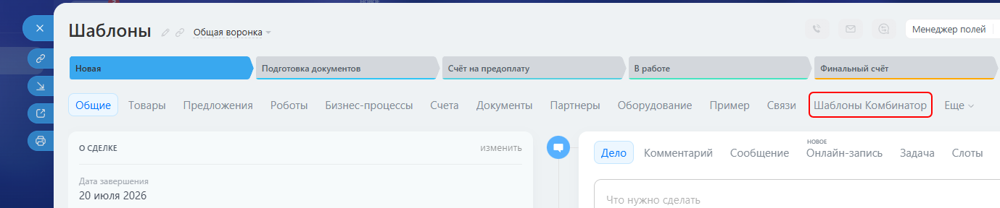

      Если пункт не отображается в основном меню, откройте раздел **«Ещё»**.

      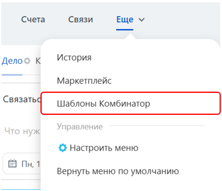

      Чтобы закрепить пункт в основном меню, нажмите **«Настроить меню»**, зажмите пункт **«Шаблоны Комбинатор»** левой кнопкой мыши и перенесите его в нужное место. Затем завершите настройку.

      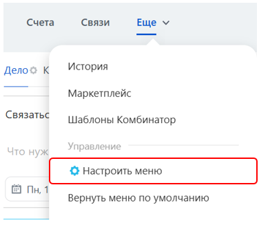

      Если пункт **«Шаблоны Комбинатор»** не отображается ни в основном меню, ни в разделе **«Ещё»**, перейдите к [настройке приложения](setting.md#интеграция) и проверьте, установлен ли флажок напротив нужной сущности.

## Создание нового шаблона

1. После перехода на вкладку **«Шаблоны Комбинатор»** нажмите кнопку **«Новый шаблон»**.

      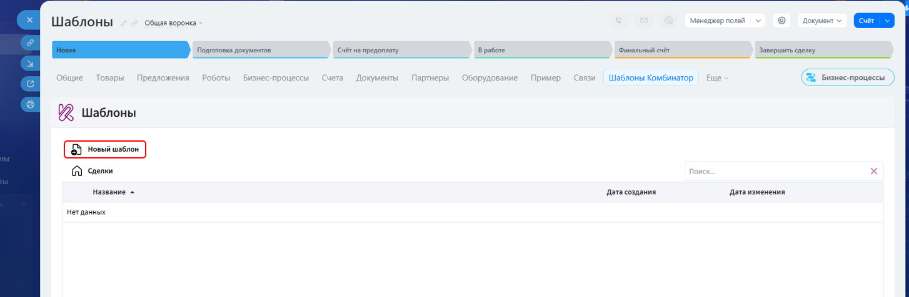

2. Введите название шаблона и нажмите кнопку **«ОК»**.

      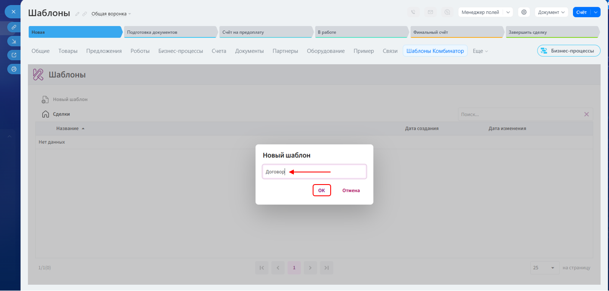

3. Откройте вкладку **«Файл»**, нажмите кнопку **«Открыть»** и выберите на устройстве документ в формате **DOCX**, который необходимо преобразовать в шаблон.

      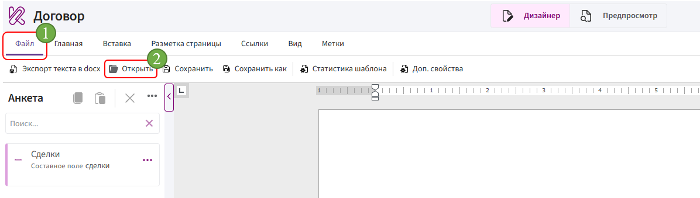

## Добавление полей в анкету

**Анкета** — это панель в левой части редактора, содержащая поля, данные из которых используются для заполнения шаблона.

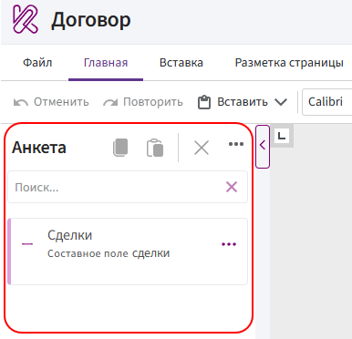

1. Нажмите на три точки напротив блока с названием нужной сущности, например **«Сделки»**, и выберите пункт **«Редактирование поля»**.

      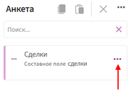

2. В открывшемся окне найдите нужные поля с помощью поиска или прокрутки списка.

      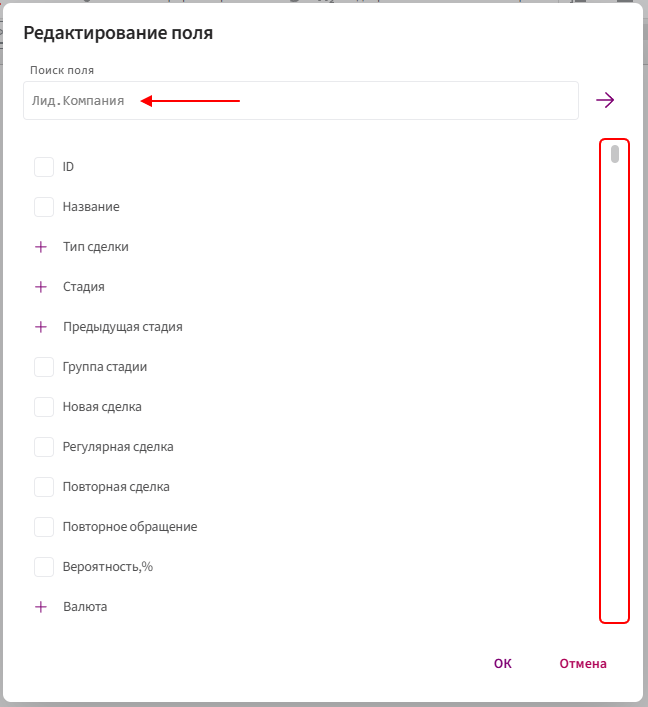

3. Установите флажки напротив полей, которые необходимо добавить в анкету, и нажмите кнопку **«ОК»**.

      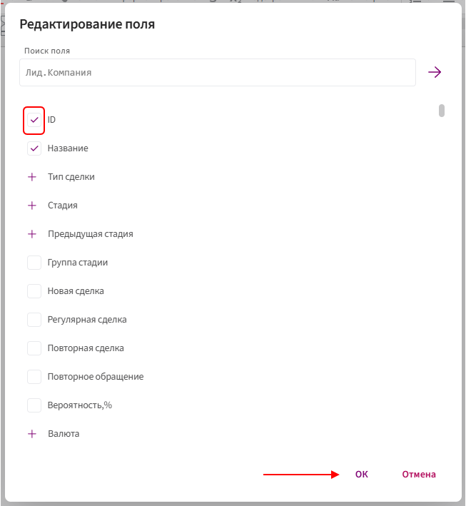

**Примечание.** Пользовательские поля Битрикс24 обозначаются префиксом `UF_CRM_`.

## Добавление полей в документ

Общий порядок вставки:

1. Установите курсор в нужное место документа.

      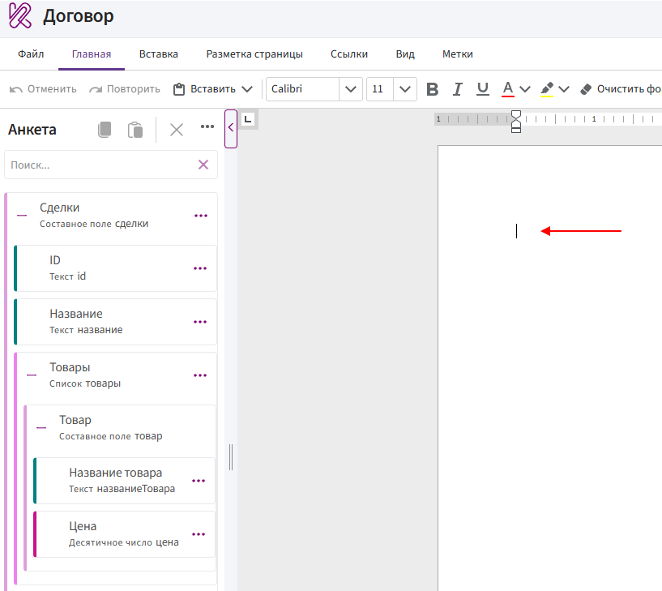

2. Найдите поле в анкете.

3. Нажмите на три точки напротив поля.

4. Выберите способ вставки.

      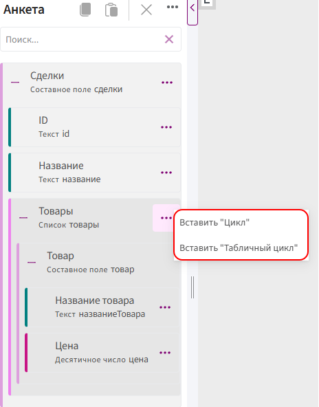

## Работа с полями в документе

**Пример:**

<video controls preload="metadata" style="width: 100%; max-width: 900px;">
  <source src="../../img/bitrix/34.mp4" type="video/mp4">
  Ваш браузер не поддерживает воспроизведение видео.
</video>

Поля из анкеты можно вставить в документ как **значение**, **условие**, **выбор**, **цикл** или **табличный цикл**.

Перед добавлением поля определите его тип и проверьте, не находится ли оно внутри списка.

### Как определить тип поля

Тип указан под названием поля в анкете.

Например:

- **Название товара** — тип **Текст**;
- **Цена** — тип **Десятичное число**;
- **Товары** — тип **Список**;
- **Товар** — тип **Составное поле**.

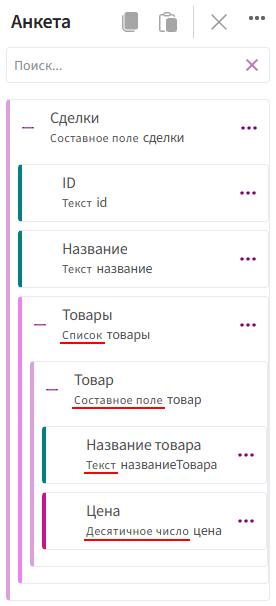

Вложенность полей показана с помощью отступов. Чем правее расположено поле, тем глубже оно находится в структуре.

### Чем отличаются способы вставки

| Способ вставки | Принцип работы | Для каких полей предназначен |
|---|---|---|
| **Вставить "Значение"** | Подставляет в документ значение поля | [Текст](../typesField/text.md), [число](../typesField/decimal.md), [дата](../typesField/date.md) |
| **Вставить "Условие"** | Управляет отображением фрагмента документа. Фрагмент выводится только при выполнении заданного условия | [Да/Нет](../typesField/boolean.md) |
| **Вставить "Выбор"** | Позволяет задать отдельное содержимое для каждого варианта поля | [Текст](../typesField/text.md) |
| **Вставить "Цикл"** | Создаёт повторяющуюся конструкцию. Внутри неё размещаются текст и поля элементов списка. Содержимое повторяется для каждого элемента | [Список](../typesField/list.md) |
| **Вставить "Табличный цикл"** | Работает как обычный цикл, но повторяет строки таблицы. В ячейки повторяемой строки можно вставить поля элементов списка | [Список](../typesField/list.md) |

> **Примечание.** Для каждого типа поля доступен определённый набор функций. В таблице приведены ссылки на описания типов полей с указанием доступных функций.

### Ошибка «Маркер должен быть внутри…»

Сообщение **«Маркер должен быть внутри…»** появляется, если поле находится внутри списка, но добавляется в документ за его пределами.

Например, при попытке вставить поле **«Название товара»** вне цикла появится сообщение:

> Маркер должен быть внутри Товары.

Это означает, что поле **«Название товара»** находится внутри списка **«Товары»**.

В этом случае:

1. Добавьте поле **«Товары»** как цикл или табличный цикл.

2. Установите курсор внутрь добавленной конструкции.

3. Добавьте поле **«Название товара»** как значение.

> Если после этого появляется аналогичное сообщение с названием другого списка, значит поле находится внутри нескольких вложенных списков. Добавьте отдельный цикл для каждого списка, двигаясь от внешнего списка к внутреннему.

---

После создания шаблона:

- если документ должен формироваться автоматически с помощью роботов или бизнес-процессов Битрикс24, переходите к [автоматизации шаблона](template-automation.md);
- если автоматизация не требуется, переходите к [формированию документа](../../UserInterface/Documents/add-document.md).