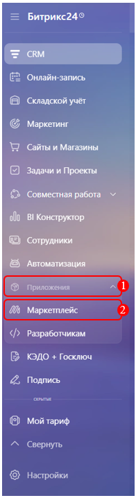
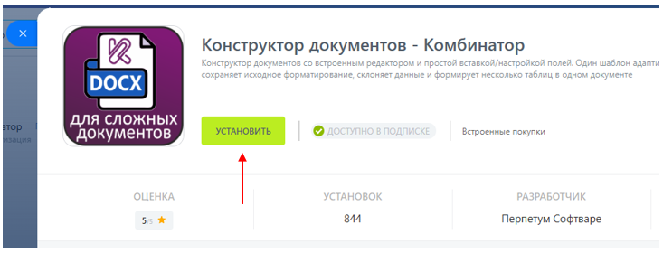
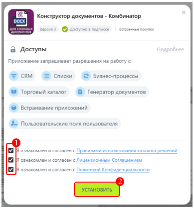
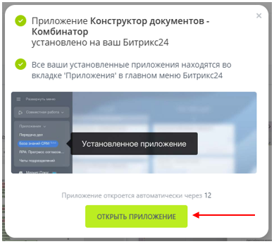

# Установка приложения  

1. Откройте **Маркетплейс**.

2. Введите в строку поиска **«Комбинатор»** и откройте найденное приложение.

      

3. Нажмите кнопку **«Установить»**.

      

4. В открывшемся окне ознакомьтесь с правилами использования приложения и нажмите кнопку **«Установить»**.

      

5. После завершения установки нажмите кнопку **«Открыть приложение»** и перейдите к его [настройке](setting.md).

      