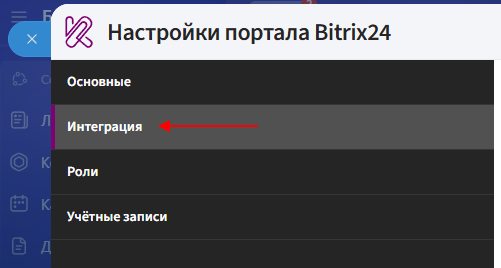
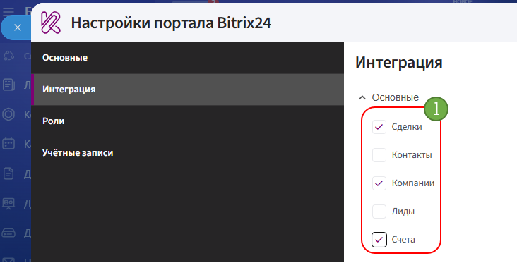
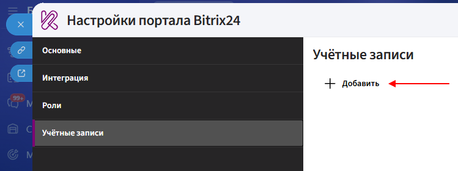
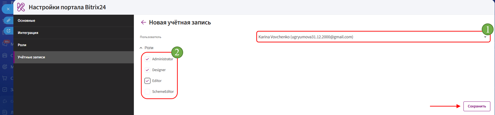

# Настройка приложения  

## Интеграция

**Интеграция** — это настройка, определяющая, в карточках каких сущностей Битрикс24 будет доступно приложение.

1. Откройте вкладку **«Интеграция»**.

      

2. Установите флажки напротив сущностей, в карточках которых должно отображаться приложение.

      

3. Нажмите кнопку **«Сохранить»**. 

## Роли

Во вкладке **«Роли»** настраиваются наборы прав, которые затем назначаются пользователям приложения «Комбинатор».

В приложении уже созданы роли **Administrator**, **Designer** и **Editor**. При необходимости можно создать собственную роль и самостоятельно определить доступные для неё действия.

**Роли по умолчанию**

1. **Designer** — роль с доступом к просмотру и редактированию шаблонов, а также с правами администратора организации.

      Для неё включены:

      - **Шаблоны — чтение**;
      - **Шаблоны — редактирование**;
      - **Администратор организации**.

2. **Editor** — роль с доступом только к чтению шаблонов.

      Для неё включено право:

      - **Шаблоны — чтение**.

3. Роль **Administrator** также создаётся по умолчанию.

**Добавление роли**

Чтобы создать собственную роль:

1. Откройте вкладку **«Роли»**.

2. Нажмите **«Добавить»**.

3. Укажите **наименование** роли.

4. Выберите необходимые права:

      - **Шаблоны — чтение** — доступ к просмотру шаблонов;
      - **Шаблоны — редактирование** — доступ к редактированию шаблонов;
      - **Администратор организации** — права администратора организации.

5. Нажмите **«Сохранить»**.

Созданную роль можно назначить сотруднику во вкладке **«Учётные записи»**.

## Учетные записи 

**Учётные записи** — это сотрудники Битрикс24, которым предоставляется доступ к приложению «Комбинатор».

1. Откройте вкладку **«Учётные записи»**.

2. Нажмите кнопку **«Добавить»**.

      

3. В поле **«Пользователь»** выберите нужного сотрудника.

4. Назначьте сотруднику необходимые роли и нажмите кнопку **«Сохранить»**.

      

После завершения настройки перейдите к [созданию шаблона](creat.md).