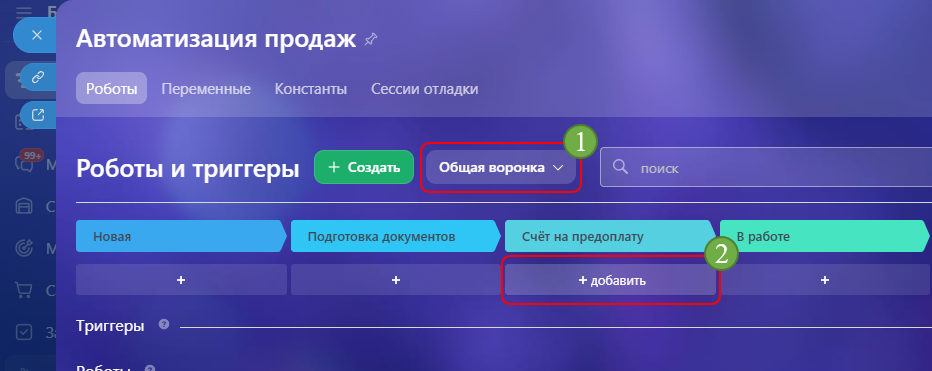
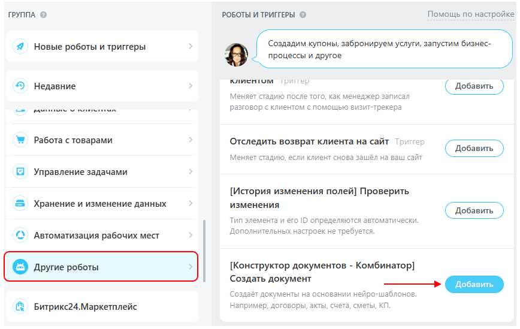
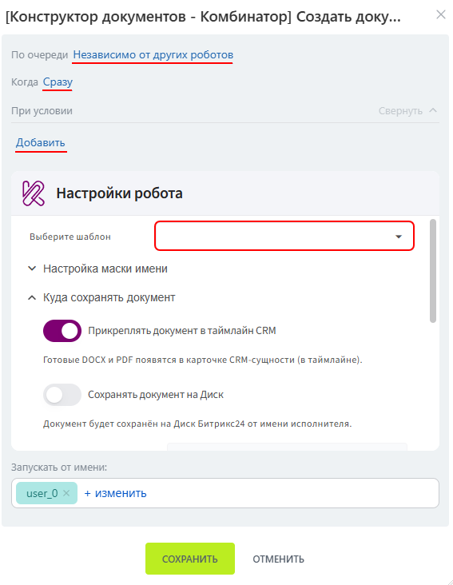
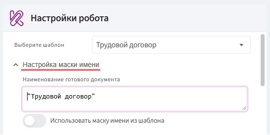
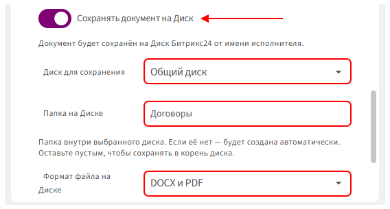
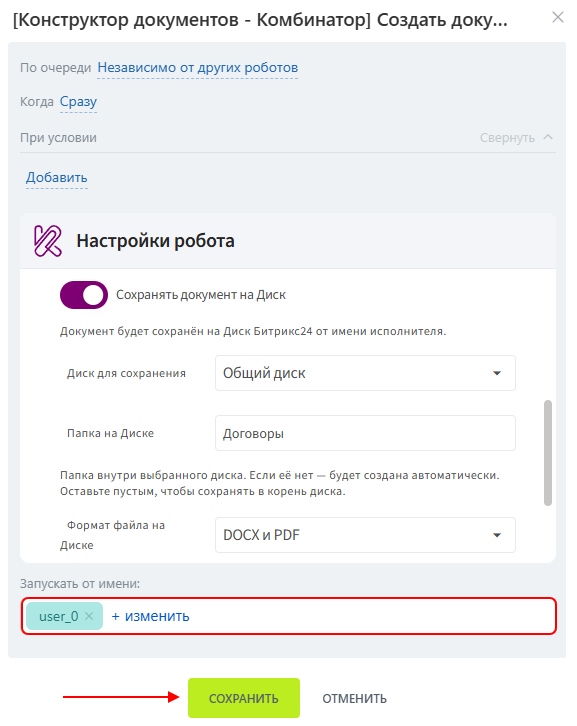
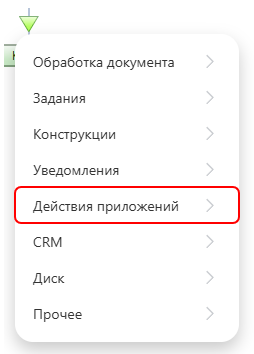
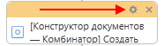

# Автоматизация шаблона
Формирование документа по шаблону можно автоматизировать с помощью робота Битрикс24.

Робота можно добавить:

- в автоматизацию CRM — документ сформируется при переходе элемента на определённую стадию;
- в бизнес-процесс — документ сформируется при выполнении соответствующего действия процесса.

Перед настройкой автоматизации убедитесь, что шаблон документа создан и сохранён, а приложение подключено к нужной сущности Битрикс24.

## Добавление робота в CRM

Робот формирует документ, когда элемент CRM переходит на стадию, на которой он установлен.

### Добавление робота

1. Перейдите в раздел **CRM**.

2. Откройте нужную сущность. Например, **Сделки**.

3. Перейдите на вкладку **«Роботы»**.

      

4. Выберите нужную воронку.

5. На стадии, при переходе на которую должен формироваться документ, нажмите **«+ добавить»**.

      

6. В группе **«Другие роботы»** найдите робота **«[Конструктор документов — Комбинатор] Создать документ»**.

7. Нажмите кнопку **«Добавить»**.

      

8. В открывшемся окне настройте условия, очередность и время выполнения робота.

9. В разделе **«Настройки робота»** выберите шаблон, на основе которого должен формироваться документ.

      

### Настройка маски имени

1. Раскройте раздел **«Настройка маски и имени»**.

      

2. По умолчанию в поле маски указано название выбранного шаблона в двойных кавычках. Если настройки не менять, оно будет использовано в качестве названия документа.

3. При необходимости измените способ формирования названия:

      - если маска имени уже настроена в шаблоне, включите параметр **«Использовать маску имени из шаблона»**;
      - если маска в шаблоне не настроена, укажите её непосредственно в настройках робота;
      - если отдельная маска не требуется, оставьте название шаблона, указанное по умолчанию.

> Поле маски имени не может быть пустым.

### Сохранение документа на Диск

По умолчанию сформированный документ прикрепляется к таймлайну карточки. Дополнительно его можно сохранить на Диск Битрикс24.

1. Включите параметр **«Сохранять документ на Диск»**.

2. Выберите диск для сохранения: общий или личный.

3. Укажите название папки. Робот проверит, существует ли на выбранном диске папка с таким названием:

    - если папка существует, документы будут сохраняться в неё;
    - если папки нет, робот создаст её автоматически.

4. Выберите формат файлов, которые будут сохраняться на Диск.

      

### Завершение настройки

1. Укажите сотрудника, от имени которого будет запускаться робот.

2. Нажмите кнопку **«Сохранить»**.

      

После этого робот будет формировать документ при переходе элемента CRM на выбранную стадию.

## Добавление робота в бизнес-процесс

Настройки робота в бизнес-процессе практически не отличаются от настроек робота в CRM. Основное отличие заключается в способе запуска: обычный робот выполняется при переходе элемента CRM на определённую стадию, а робот в бизнес-процессе — при переходе к соответствующему действию.

### Создание бизнес-процесса

1. Перейдите в раздел **«Автоматизация»**.

2. Откройте **«Бизнес-процессы»** и выберите **«Процессы в CRM»**.

3. Выберите сущность, для которой необходимо настроить формирование документов. Например, **Сделки**.

4. Нажмите кнопку **«Добавить шаблон»**.

5. Укажите название бизнес-процесса.

6. При необходимости настройте условия его автоматического запуска:

      - при создании элемента CRM;
      - при изменении элемента CRM.

      Если автоматический запуск не требуется, бизнес-процесс можно будет запускать вручную из карточки CRM.

7. Сохраните настройки и перейдите в конструктор бизнес-процесса.

### Добавление робота

В бизнес-процессе робот добавляется как отдельное действие.

1. Нажмите на стрелку в том месте бизнес-процесса, где должен формироваться документ.

2. В списке действий выберите **«Действия приложений» → «[Конструктор документов — Комбинатор] Создать документ»**.

      

3. Нажмите на значок шестерёнки у добавленного действия, чтобы открыть его настройки.

      

4. Настройте действие аналогично [роботу в CRM](#crm): выберите шаблон, укажите маску имени, место сохранения и формат документа.

5. Укажите сотрудника, от имени которого будет выполняться действие.

6. Сохраните настройки действия и шаблон бизнес-процесса.

> В бизнес-процессе не требуется отдельно указывать стадию, очередность и время выполнения робота. Порядок и условия его запуска определяются расположением действия и логикой бизнес-процесса.