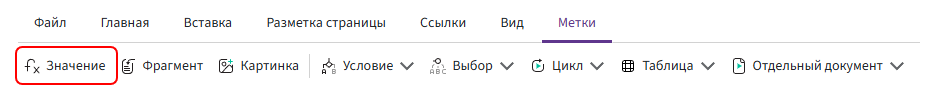

# Метка «Значение»

Метка **«Значение»** используется для вывода в документ значения поля или результата выражения: текста, числа, даты, результата вычисления или функции.



## Выражение

При добавлении метки указывается выражение, результат которого необходимо вывести в документ.

Для обычного поля указывается его идентификатор:

```text
имяКлиента
```

Для вложенного поля указывается полный путь через точку (`.`):

```text
сделки.фио
```

В метке также можно использовать более сложные выражения, например:

- вычисление — `количество * цена`;
- функцию — `форматДаты(датаДоговора, ФорматДаты.ДатаКратко)`;
- объединение значений — `"Договор № " & номерДоговора`;
- условную функцию — `если(...)`.

Правила записи выражений описаны в разделе [«Основные правила»](../syntax/syntax.md).

## Ограничения

Метка **«Значение»** не предназначена для повторяющегося вывода элементов списка. Для этого используются метки [«Цикл»](for.md) и [«Таблица»](table.md).

Чтобы показывать или скрывать часть документа в зависимости от условия, используйте метку [«Условие»](if.md).