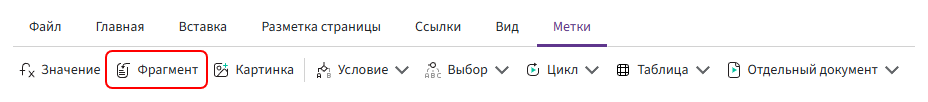

# Метка «Фрагмент»

Метка **«Фрагмент»** вставляет в формируемый документ содержимое другого шаблона.

В качестве фрагмента можно использовать любой шаблон. Например, в шаблон договора можно вставить шаблон акта, счёта или другого документа.



## Добавление метки

1. Установите курсор в место шаблона, куда необходимо вставить содержимое другого шаблона.
2. На вкладке **«Метки»** выберите **«Фрагмент»**.
3. Укажите путь к фрагменту и при необходимости добавьте параметры.

## Передача значений

Поля выбранного шаблона заполняются данными из основного шаблона.

### Поля с одинаковыми идентификаторами

Если в основном и выбранном шаблонах используются поля с одинаковыми идентификаторами, добавлять параметры при настройке метки не нужно.

Например, если в обоих шаблонах есть поле:

```text
контрагент
```

поле `контрагент` в выбранном шаблоне будет заполнено значением из основного шаблона.

### Поля с разными идентификаторами

Если нужные поля в основном и выбранном шаблонах имеют разные идентификаторы, настройте передачу значения через параметр.

Например:

- в основном шаблоне есть поле `контрагент`;
- в выбранном шаблоне есть поле `исполнитель`;
- значение поля `контрагент` должно передаваться в поле `исполнитель`.

Для этого в настройках метки укажите:

**«Имя параметра»** — идентификатор поля, которое нужно заполнить в выбранном шаблоне:

```text
исполнитель
```

**«Выражение параметра»** — поле основного шаблона, из которого нужно взять значение:

```text
контрагент
```

В результате значение поля `контрагент` будет передано в поле `исполнитель`.

## Поля выбранного шаблона

Если в выбранном шаблоне есть поля, значения для которых не передаются через параметры, эти поля должны быть доступны и в анкете основного шаблона.

Например, в выбранном шаблоне используется поле `номерСчета`, а в основном шаблоне такого поля нет. Чтобы пользователь мог заполнить его при работе с основным шаблоном, поле `номерСчета` необходимо добавить в анкету основного шаблона.