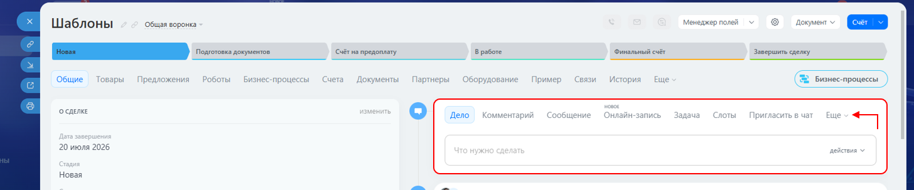
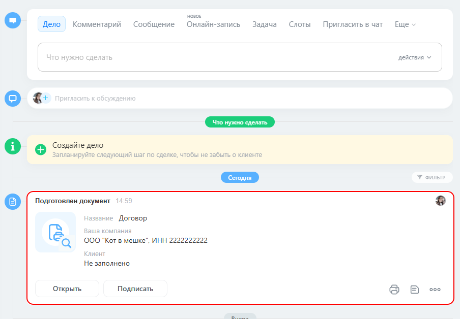

# Формирование документа

Сформируйте итоговый документ из карточки Битрикс24. Это позволит проверить работу шаблона с реальными данными CRM.

## Подготовка карточки

1. Откройте карточку CRM, для которой настроен шаблон. Например, сделку.

2. Проверьте, заполнены ли поля, данные из которых должны попасть в документ.

3. При необходимости добавьте или исправьте данные в карточке.

## Формирование документа

1. В панели действий над таймлайном нажмите **«Новый документ»**.

      Если кнопка не отображается в основной панели, откройте меню **«Ещё»**.

      

2. Выберите **«Новый документ»**.

3. Выберите подготовленный шаблон.

4. Дождитесь загрузки данных из карточки в шаблон.

5. Нажмите **«Готово»** в правом верхнем углу.

6. Укажите название документа и нажмите **«ОК»**.

Сформированный документ появится в таймлайне карточки.

## Проверка результата

Откройте сформированный документ и проверьте:

- правильно ли подставились данные из карточки;
- сработали ли условия и выбранные варианты;
- корректно ли сформировались таблицы и расчёты;
- сохранилось ли оформление документа.

Если ошибка связана с данными, исправьте их в карточке и сформируйте документ повторно.

Если ошибка находится в логике или оформлении, вернитесь к редактированию шаблона, внесите изменения и повторите проверку.