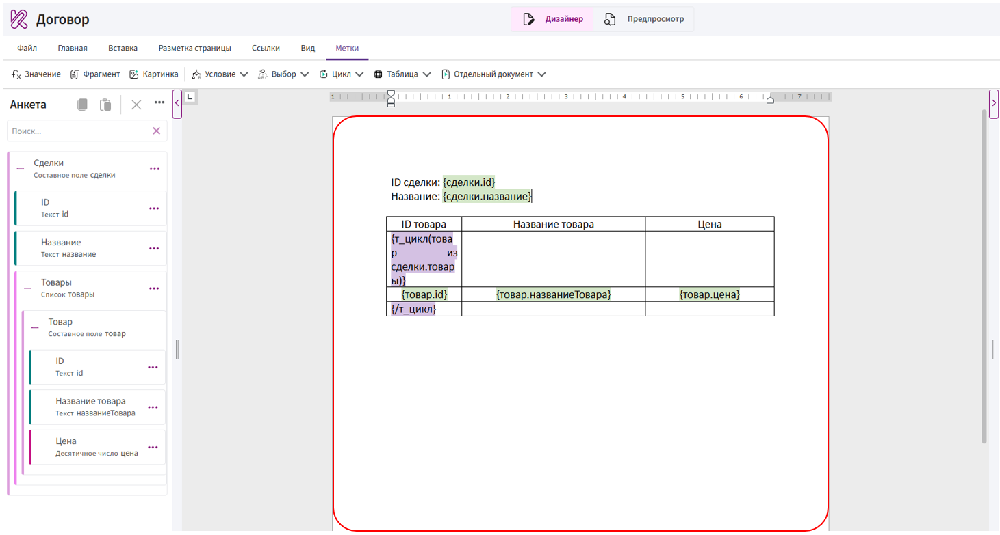
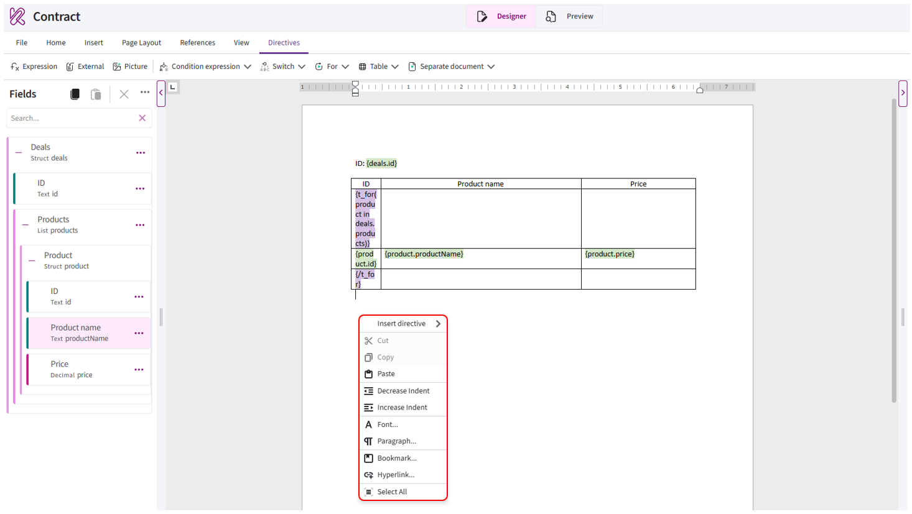
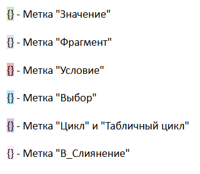
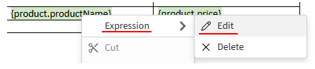

# Область редактирования

**Область редактирования** — это основная часть редактора, в которой отображается и редактируется содержимое шаблона.

Здесь можно работать с текстом, таблицами, изображениями и добавленными метками.

## Работа с содержимым шаблона

В области редактирования можно:

- вводить и изменять текст;
- настраивать шрифт, размер и начертание текста;
- изменять выравнивание, отступы и интервалы;
- создавать списки;
- добавлять и редактировать таблицы;
- вставлять изображения;
- изменять параметры страницы;
- размещать и редактировать метки.

Для добавления или изменения содержимого установите курсор в нужное место документа. Чтобы применить оформление к уже добавленному содержимому, предварительно выделите его.

Работа с текстом и его оформлением выполняется так же, как в обычном текстовом редакторе.

## Контекстное меню

Контекстное меню содержит команды для работы с содержимым документа. Чтобы открыть его, нажмите правой кнопкой мыши в области редактирования.

В контекстном меню доступны следующие команды:

- **«Вставить метку»** — открывает меню добавления меток;
- **«Вырезать»**, **«Копировать»** и **«Вставить»** — используются для работы с содержимым документа;
- **«Уменьшить отступ»** и **«Увеличить отступ»** — изменяют отступ выбранного абзаца;
- **«Шрифт»** — открывает настройки шрифта;
- **«Абзац»** — открывает настройки выравнивания, отступов и интервалов;
- **«Закладка»** — позволяет добавить или изменить закладку;
- **«Гиперссылка»** — позволяет добавить ссылку;
- **«Выбрать всё»** — выделяет всё содержимое документа.

Доступность команд зависит от места открытия контекстного меню и наличия выделенного содержимого. Например, команды **«Вырезать»** и **«Копировать»** недоступны, если в документе ничего не выделено.

## Добавление полей из анкеты

Поля из анкеты добавляются в то место области редактирования, где установлен курсор. После вставки в документе появляется метка или специальная конструкция, которая обрабатывается Комбинатором при формировании документа.

Порядок добавления полей, способы их вставки и правила работы с ними описаны в статье [«Анкета»](fields.md#_12).

## Редактирование меток

Все поля и конструкции, добавленные в документ, Комбинатор воспринимает как метки. Каждый тип метки имеет свой цвет, поэтому их можно визуально различать в тексте шаблона.

Цвет используется только для отображения меток в редакторе и не переносится в сформированный документ.

Для изменения настроек метки используется специальное окно.

Открыть окно редактирования можно одним из способов:

- дважды нажать левой кнопкой мыши на метку;
- нажать на метку правой кнопкой мыши, раскрыть первый пункт контекстного меню и выбрать **«Редактировать»**.
       

Название первого пункта зависит от типа выбранной метки. Например, для простого поля отображается пункт **«Значение»**, а для поля, вставленного как условие, — пункт **«Условие»**.

После этого откроется окно **«Редактировать метку "..."»**. Измените необходимые настройки и нажмите кнопку **«ОК»**.