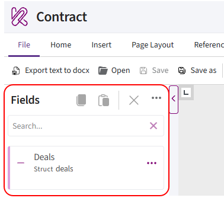
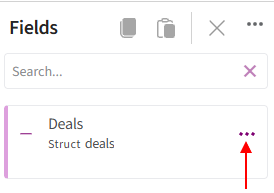
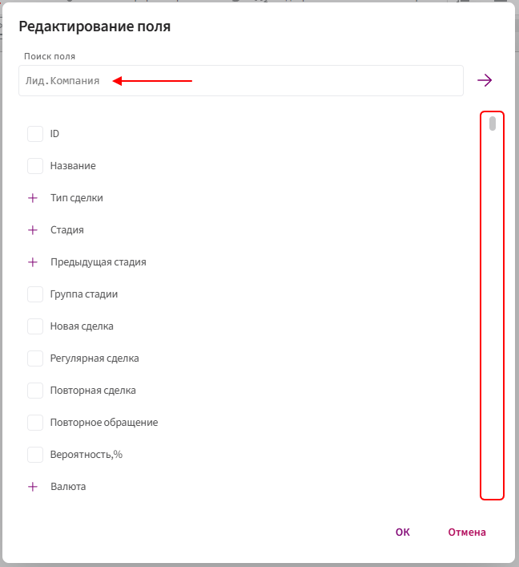
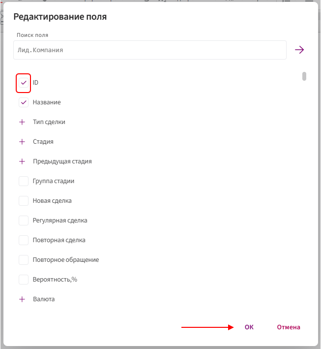
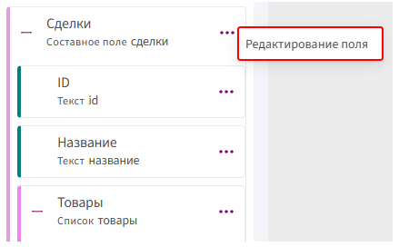
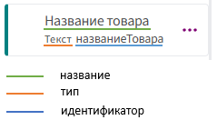
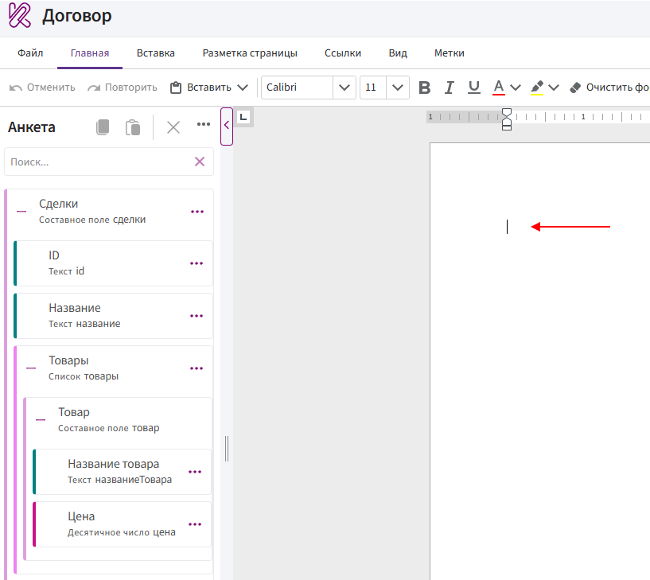
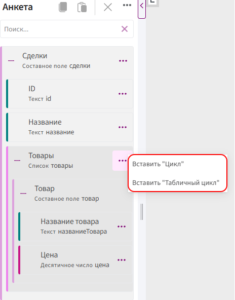

# Анкета

**Анкета** — это панель в левой части редактора, в которой отображаются поля Битрикс24, доступные для использования в шаблоне.

При формировании документа Комбинатор получает значения этих полей из карточки CRM и подставляет их в шаблон.

## Как анкета участвует в формировании документа

Анкета связывает поля Битрикс24 с шаблоном документа.

Например:

1. В карточке сделки поле **«Название сделки»** содержит значение **«Поставка оборудования»**.

2. Поле **«Название сделки»** добавлено в анкету.

3. Из анкеты оно вставлено в шаблон как значение.

4. При формировании документа вместо метки появится текст **«Поставка оборудования»**.

Если поле в карточке Битрикс24 не заполнено, Комбинатору нечего будет подставить в документ.

## Добавление полей в анкету

Все поля анкеты находятся внутри основного блока, название которого соответствует сущности CRM.

Например, если шаблон создаётся из карточки сделки, основной блок будет называться **«Сделки»**.

Чтобы добавить поля в анкету:

1. Откройте шаблон документа.

2. Нажмите на три точки напротив основного блока анкеты. Например, напротив блока **«Сделки»**.

      

3. Выберите **«Редактирование поля»**.

4. В открывшемся окне найдите нужные поля. Для поиска можно использовать строку поиска или прокрутить список.

      

5. Установите флажки напротив полей, которые необходимо добавить.

6. Нажмите кнопку **«ОК»**.

      

Выбранные поля появятся внутри основного блока анкеты.

> В анкету можно добавить только те поля, которые уже существуют в соответствующей сущности CRM.

## Изменение набора полей

Чтобы добавить новые или убрать ненужные поля:

1. Нажмите на три точки напротив основного блока анкеты.

2. Выберите **«Редактирование поля»**.

      

3. Установите флажки напротив новых полей или снимите их с полей, которые больше не нужны.

4. Нажмите кнопку **«ОК»**.

Удаление поля из анкеты не удаляет его из Битрикс24.

> Перед удалением поля из анкеты убедитесь, что оно не используется в тексте шаблона.

## Название, тип и идентификатор

Для каждого поля в анкете отображаются:

- название;
- тип;
- идентификатор.

Тип и идентификатор указаны под названием поля.

> Идентификаторы позволяют различать поля с одинаковыми или похожими названиями. Они также используется внутри меток и функций Комбинатора.

## Добавление полей в документ

Общий порядок вставки:

1. Установите курсор в нужное место документа.

      

2. Найдите поле в анкете.

3. Нажмите на три точки напротив поля.

4. Выберите способ вставки.

      

**Пример:**

<video controls preload="metadata" style="width: 100%; max-width: 900px;">
  <source src="../../../ReferenceGuide/img/bitrix/34.mp4" type="video/mp4">
  Ваш браузер не поддерживает воспроизведение видео.
</video>

Поля из анкеты можно вставить в документ как **значение**, **условие**, **выбор**, **цикл** или **табличный цикл**.

Перед добавлением поля определите его тип и проверьте, не находится ли оно внутри списка.

## Почему поля зависят друг от друга

Зависимость поля определяется не только его типом, но и расположением в анкете.

Поле **«Название товара»** имеет тип **«Текст»**, но находится внутри списка **«Товары»**. Поскольку в сделке может быть несколько товаров, у каждого из них будет своё название.

Если добавить **«Название товара»** в документ как обычное значение, Комбинатор не сможет определить, название какого товара необходимо подставить, и выдаст [ошибку](fields.md#_14).

Сначала нужно добавить список **«Товары»** как цикл, а затем разместить поле **«Название товара»** внутри него.

## Ошибка «Маркер должен быть внутри…»

Сообщение **«Маркер должен быть внутри…»** появляется, если поле находится внутри списка, но добавляется в документ за его пределами.

Например, при попытке вставить поле **«Название товара»** вне цикла появится сообщение:

> Маркер должен быть внутри Товары.

Это означает, что поле **«Название товара»** находится внутри списка **«Товары»**.

В этом случае:

1. Добавьте поле **«Товары»** как цикл или табличный цикл.

2. Установите курсор внутрь добавленной конструкции.

3. Добавьте поле **«Название товара»** как значение.

> Если после этого появляется аналогичное сообщение с названием другого списка, значит поле находится внутри нескольких вложенных списков. Добавьте отдельный цикл для каждого списка, двигаясь от внешнего списка к внутреннему.