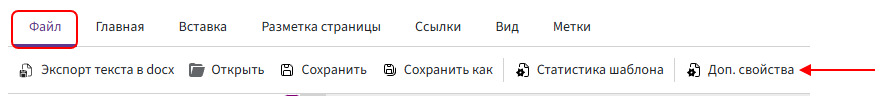

# Маска имени файла

**Маска имени** — это выражение, по которому Комбинатор формирует имя готового файла.

С помощью маски можно заранее задать, из каких частей будет состоять имя файла. Например, объединить название документа, номер договора, дату и наименование организации.

В результате файл может получить следующее имя: `Договор №125 от 28.07.2026`

При формировании документа номер и дата будут автоматически подставлены из соответствующих полей.

## Как перейти к настройке маски имени

Настройка маски имени выполняется в режиме редактирования шаблона.

> В Битрикс24 маску имени также можно указать непосредственно в [настройках робота](/ReferenceGuide/Bitrix/template-automation/#_3) Комбинатора. Для маски, заданной в роботе, действуют те же правила записи, что и для маски в шаблоне.
>
> Если маска уже сохранена в шаблоне, в настройках робота можно выбрать **«Использовать маску имени из шаблона»** — повторно составлять выражение не потребуется.

Чтобы открыть настройки маски в шаблоне:

1. В верхней части редактора перейдите на вкладку **«Файл»**.

2. Нажмите кнопку **«Доп. свойства»**.

      

3. В поле **«Маска имени»** укажите выражение, по которому будет формироваться имя файла.

4. Нажмите **«ОК»**, чтобы сохранить маску.

## Что можно использовать в маске имени

В маске имени можно использовать:

- статичный текст;
- метки полей;
- операторы;
- функции;
- другие синтаксические конструкции, поддерживаемые Комбинатором.

Маска имени обрабатывается по тем же правилам, что и выражения внутри шаблона.

### Статичный текст

Статичный текст — это часть имени, которая остаётся одинаковой при каждом формировании документа.

Его необходимо заключать в двойные кавычки:

```
"Договор"
```

или:

```
"Договор № "
```

Текст внутри кавычек будет добавлен в имя файла без изменений.

### Метки полей

Метки позволяют добавлять в имя файла значения полей.

При формировании документа метка заменяется фактическим значением соответствующего поля.

Например, метка `номерДоговора` может передавать номер договора, а метка `датаДоговора` — дату его заключения.

Названия и доступность меток зависят от полей, добавленных в шаблон.

### Функции и другие конструкции

В маске имени можно использовать функции и другие конструкции синтаксиса Комбинатора.

Например, функции можно применять для форматирования даты, изменения текста или обработки значений перед их добавлением в имя файла.

### Оператор объединения

Все части маски необходимо соединять оператором объединения `&`.

Оператор `&` объединяет статичный текст, значения меток и результаты других выражений в одно имя файла.

Например:

```
"Договор № " & сделки.id
```

Если поле `id` содержит значение `125`, будет сформировано имя:

```
Договор № 125
```

Чтобы добавить несколько значений, оператор `&` необходимо указывать между каждой частью маски:

```
"Договор № " & сделки.id & " от " & форматДаты(сделки.датаДоговора,ФорматДаты.ДатаКратко)
```

В результате может быть сформировано имя:

```
Договор № 125 от 28.07.2026
```

Таким образом, маска состоит из следующих частей:

1. `"Договор № "` — статичный текст.
2. `&` — оператор объединения.
3. `сделки.id` — метка поля.
4. `" от "` — статичный текст.
5. `форматДаты(сделки.датаДоговора,ФорматДаты.ДатаКратко)` — метка обернутая в функцию.

Оператор `&` ставится только между объединяемыми значениями. Его не нужно добавлять перед первой или после последней части маски.

## Использование символа «/»

Символ `/` нельзя использовать как часть имени файла, поскольку Комбинатор воспринимает его как разделитель пути.

Не используйте `/` для разделения частей номера документа, даты или других значений.

Например, вместо:

```
"Договор 125/2026"
```

используйте:

```
"Договор 125-2026"
```