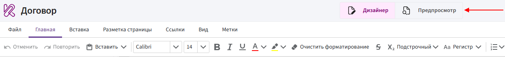
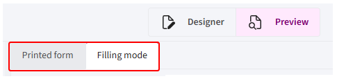
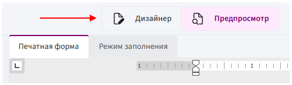

# Режим предпросмотра

**Режим предпросмотра** позволяет проверить подстановку данных, работу меток и внешний вид шаблона до формирования готового документа.

В режиме предпросмотра можно проверить:

- какие данные подставляются вместо меток;
- правильно ли работают условия и варианты выбора;
- корректно ли обрабатываются циклы и табличные циклы;
- как отображаются таблицы и изображения;
- как выглядит документ после обработки шаблона.

Источник данных для предпросмотра зависит от используемой версии Комбинатора.

## Предпросмотр в Битрикс24

В Битрикс24 данные для предпросмотра автоматически загружаются из карточки CRM, из которой открыт шаблон.

Например, если шаблон открыт из карточки сделки, Комбинатор использует данные этой сделки.

1. Перейдите в режим предпросмотра.

    

2. Выберите вариант отображения: **«Режим заполнения»** или **«Печатная форма»**.

    

3. Проверьте результат обработки шаблона.

> Если нужное поле в карточке Битрикс24 не заполнено, его значение не отобразится в предпросмотре.

## Варианты отображения документа

В режиме предпросмотра доступны два варианта отображения документа: **«Режим заполнения»** и **«Печатная форма»**.

### Режим заполнения

В режиме заполнения используется упрощённое отображение документа.

Этот режим подходит для быстрой проверки:

- подстановки значений;
- работы условий;
- вариантов выбора;
- повторения элементов в циклах;
- заполнения таблиц.

> Внешний вид документа в режиме заполнения может отличаться от итогового файла. Например, могут иначе отображаться отступы, интервалы, расположение элементов.

### Печатная форма

Печатная форма отображает документ в виде, приближённом к результату его формирования в формате DOCX или PDF.

Этот вариант следует использовать для проверки:

- расположения текста на странице;
- шрифтов и оформления;
- отступов и интервалов;
- таблиц и изображений;
- переносов строк и страниц;
- общего внешнего вида документа.

Между печатной формой и сформированным файлом возможны небольшие различия в форматировании.

> Для проверки данных и логики используйте **режим заполнения**, а для проверки внешнего вида документа — **печатную форму**.

## Возврат к редактированию

Если при проверке обнаружена ошибка, вернитесь в **Дизайнер** и внесите изменения в шаблон.

После этого повторно откройте режим предпросмотра и проверьте результат.

> Предпросмотр помогает проверить работу шаблона, но не заменяет проверку готового документа. Перед использованием шаблона сформируйте тестовый файл в формате DOCX или PDF.