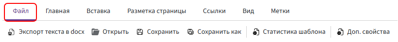
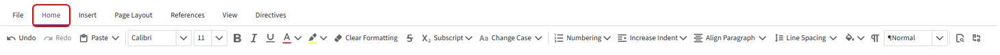
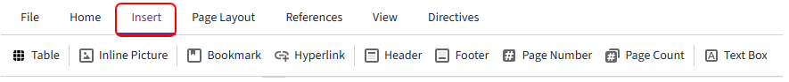
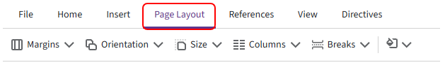
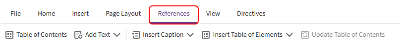
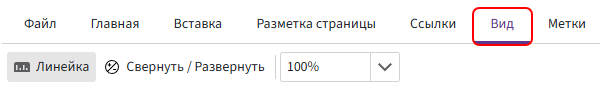
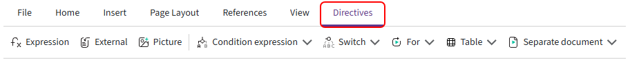
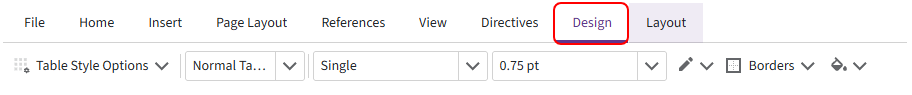
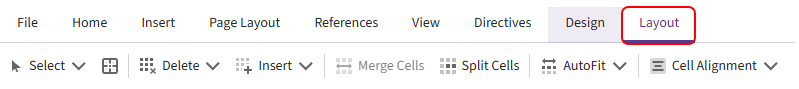

# Панель инструментов

Панель инструментов содержит команды для редактирования и оформления шаблона. С её помощью можно форматировать текст, добавлять таблицы, изображения и метки Комбинатора, а также настраивать параметры страниц.

> Некоторые вкладки появляются только при работе с определёнными элементами. Например, вкладки **«Конструктор»** и **«Макет»** доступны, когда курсор установлен внутри таблицы.

## Вкладка «Файл»

На вкладке доступны следующие команды:

1. **Экспорт текста в docx** — экспортирует текстовое содержимое шаблона вместе с метками, условиями, циклами и функциями в файл формата `.DOCX`.

      Полученный документ можно открыть в другом шаблоне через **«Файл» → «Открыть»**. Все конструкции Комбинатора сохранятся.

      > Поля анкеты не переносятся. Если метки связаны с полями анкеты, добавьте такие же поля в новый шаблон.

2. **Открыть** — загружает документ формата `.DOCX` в редактор.

      Содержимое файла используется как текстовая основа шаблона. После загрузки в него можно добавлять метки, функции и другие элементы автоматизации.

3. **Сохранить** — сохраняет изменения, внесённые в шаблон.

4. **Сохранить как** — сохраняет копию шаблона под новым именем.

5. **Статистика шаблона** — показывает количество используемых полей, меток и функций.

6. **Доп. свойства** — открывает дополнительные свойства шаблона, в которых можно настроить маску имени файла.

     Подробнее см. в статье [«Маска имени файла»](file-name-mask.md).

## Вкладка «Главная»

Основная вкладка для редактирования и форматирования текста.

1. **Отменить** — отменяет последнее действие.

2. **Повторить** — повторяет последнее действие

3. **Вставить** — открывает стандартное меню работы с буфером обмена:

     - `Вставить` — вставляет в шаблон текст или объект из буфера обмена, например скопированный фрагмент текста или метку.
     - `Копировать` — копирует выделенный фрагмент текста или метку в буфер обмена.
     - `Вырезать` — удаляет выделенный фрагмент из шаблона и помещает его в буфер обмена.

      Этим командам соответствуют привычные сочетания клавиш:

      - `Ctrl + V` — вставить;
      - `Ctrl + C` — копировать;
      - `Ctrl + X` — вырезать.

4. **Шрифт** — позволяет выбрать шрифт, например Calibri или Times New Roman.

5. **Размер шрифта** — задаёт размер шрифта, например 11, 12 или 14.

6. **Полужирный** — применяет к выделенному тексту полужирное начертание (`Ctrl + B`).

7. **Курсив** — применяет к выделенному тексту курсивное начертание (`Ctrl + I`).

8. **Подчёркнутый** — подчёркивает выделенный текст (`Ctrl + U`).

9. **Цвет шрифта** — изменяет цвет выделенного текста.

10. **Цвет выделения текста** — выделяет текст цветом, как маркером.

11. **Очистить форматирование** — сбрасывает применённое форматирование, включая шрифт, цвет и размер текста.

12. **Зачёркнутый** — зачёркивает выделенный текст.

13. **Надстрочный и подстрочный текст** — преобразует выделенный текст в надстрочные или подстрочные знаки.

14. **Регистр** — изменяет регистр выделенного текста:

      - `Как в предложениях` — первый символ каждого предложения становится прописным, остальные — строчными.

      - `ВСЕ ПРОПИСНЫЕ` — весь выделенный текст переводится в верхний регистр.

      - `все строчные` — весь выделенный текст переводится в нижний регистр.

      - `Начинать С Прописных` — каждое слово начинается с прописной буквы.

      - `иЗМЕНИТЬ РЕГИСТР` — строчные буквы становятся прописными, а прописные — строчными.

15. **Нумерация** — создаёт маркированные, нумерованные и многоуровневые списки.

16. **Увеличить отступ** — увеличивает или уменьшает абзацные отступы.

17. **Выравнивание абзаца** — изменяет выравнивание текста в абзаце.

18. **Межстрочный интервал** — задаёт межстрочный интервал, например 1,0; 1,5 или 2,0.

19. **Заливка** — изменяет цвет фона выделенного абзаца.

20. **Непечатаемые символы** — показывает или скрывает непечатаемые символы: пробелы, знаки абзаца, табуляцию и разрывы строк.

21. **Стили текста** — применяет к тексту выбранный стиль, например обычный текст или заголовок.

22. **Найти** — выполняет поиск текста в документе.

23. **Заменить** — находит и заменяет текст в документе.

## Вкладка «Вставка»

Содержит команды для добавления в документ таблиц, изображений, ссылок и других объектов.

1. **Таблица** — вставляет таблицу в область редактирования. Перед вставкой можно указать количество строк и столбцов.

2. **Встроенная картинка** — добавляет изображение в документ.

3. **Закладка** — создаёт закладку внутри документа. Закладки можно использовать для быстрой навигации и перехода по внутренним ссылкам.

4. **Гиперссылка** — добавляет ссылку на сайт, адрес электронной почты или место внутри документа, отмеченное закладкой.

5. **Верхний колонтитул** — добавляет содержимое, которое будет повторяться в верхней части страниц документа.

6. **Нижний колонтитул** — добавляет содержимое, которое будет повторяться в нижней части страниц документа.

7. **Номер страницы** — добавляет автоматическую нумерацию страниц.

8. **Число страниц** — добавляет общее количество страниц в документе.

9. **Текстовое поле** — добавляет отдельный текстовый блок, который можно перемещать и размещать в нужной части страницы.

## Вкладка «Разметка страницы»

Содержит команды для настройки параметров страниц документа.

1. **Поля** — настраивает отступы от краёв страницы: слева, справа, сверху и снизу.

     Можно выбрать стандартный вариант или задать собственные значения.

2. **Ориентация** — изменяет ориентацию страницы:

    - `Книжная` — вертикальная;
    - `Альбомная` — горизонтальная.

3. **Размер** — задаёт формат бумаги.

4. **Колонки** — разбивает текст на несколько колонок.

5. **Разрывы** — добавляет разрыв страницы, раздела или колонки.

6. **Цвет страницы** — изменяет цвет фона страниц документа.

## Вкладка «Ссылки»

Содержит команды для создания оглавления, подписей и списков объектов.

1. **Оглавление** — добавляет автоматическое оглавление.

2. **Добавить текст** — позволяет включить выделенный фрагмент в структуру оглавления.

3. **Вставить название** — добавляет подпись к рисунку, таблице, диаграмме или другому объекту.

4. **Список иллюстраций** — создаёт список объектов, для которых были добавлены подписи, например список рисунков или таблиц.

5. **Обновление оглавления** — обновляет структуру и номера страниц в оглавлении.

## Вкладка «Вид»

Содержит команды для настройки отображения области редактирования.

1. **Линейка** — включает или отключает горизонтальную и вертикальную линейки.

2. **Свернуть / Развернуть** — сворачивает или разворачивает метки. В свёрнутом виде метки занимают меньше места, поэтому проще оценить расположение и оформление текста.

3. **Изменить масштаб** — увеличивает или уменьшает масштаб отображения документа в области редактирования.

## Вкладка «Метки»

Вкладка содержит метки и конструкции Комбинатора, которые используются для автоматического заполнения и формирования документов.

1. **Значение** — вставляет в документ значение выбранного поля. [Подробнее](../../ReferenceGuide/directives/value.md)

2. **Фрагмент** — вставляет содержимое другого шаблона, расположенного по указанному пути. [Подробнее](../../ReferenceGuide/directives/fragment.md)

3. **Картинка** — вставляет в документ изображение из файлового поля Битрикс24. [Подробнее](../../ReferenceGuide/directives/picture.md)

4. **Условие** — добавляет конструкцию «если/иначе», которая позволяет выводить или скрывать часть документа в зависимости от заданного условия. [Подробнее](../../ReferenceGuide/directives/if.md)

5. **Выбор** — выводит один из вариантов текста в зависимости от значения выбранного поля. [Подробнее](../../ReferenceGuide/directives/switch.md)

6. **Цикл** — повторяет фрагмент документа для каждого элемента списка. [Подробнее](../../ReferenceGuide/directives/for.md)

7. **Таблица** — повторяет строки таблицы в зависимости от количества элементов в списке. [Подробнее](../../ReferenceGuide/directives/table.md)

## Вкладка «Конструктор»

Вкладка появляется, когда курсор установлен внутри таблицы. Она предназначена для оформления выбранной таблицы.

1. **Параметры стилей таблиц** — позволяет выбрать элементы таблицы, к которым будет применяться отдельное оформление.

2. **Стиль таблицы** — применяет к таблице готовый вариант оформления.

3. **Стиль линии** — задаёт вид линий границ, например одинарную линию.

4. **Толщина линии** — задаёт толщину границ таблицы.

5. **Цвет линии** — позволяет выбрать цвет границ таблицы.

6. **Границы** — добавляет или удаляет выбранные границы у таблицы или выделенных ячеек.

7. **Заливка** — изменяет цвет фона таблицы или выделенных ячеек.

> Перед применением оформления выделите нужные ячейки или установите курсор внутри таблицы.

## Вкладка «Макет»

Вкладка появляется, когда курсор установлен внутри таблицы. Содержит инструменты для изменения структуры таблицы и расположения содержимого в ячейках.

1. **Выделить** — позволяет выделить ячейку, строку, столбец или всю таблицу.

2. **Линии сетки** — показывает или скрывает границы ячеек, у которых не настроены видимые линии.

    > Линии сетки отображаются только в редакторе и не добавляются в готовый документ.

3. **Удалить** — удаляет выбранные ячейки, строки, столбцы или всю таблицу.

4. **Вставить** — добавляет новые строки или столбцы относительно выбранной ячейки.

5. **Объединить ячейки** — объединяет несколько выделенных ячеек в одну.

    > Команда становится доступна после выделения нескольких соседних ячеек.

6. **Разбить ячейки** — разделяет выбранную ячейку на несколько строк и столбцов.

7. **Автоподбор** — автоматически изменяет ширину столбцов в соответствии с содержимым таблицы или доступной шириной страницы.

8. **Выравнивание содержимого ячейки** — задаёт горизонтальное и вертикальное расположение текста внутри выбранных ячеек.